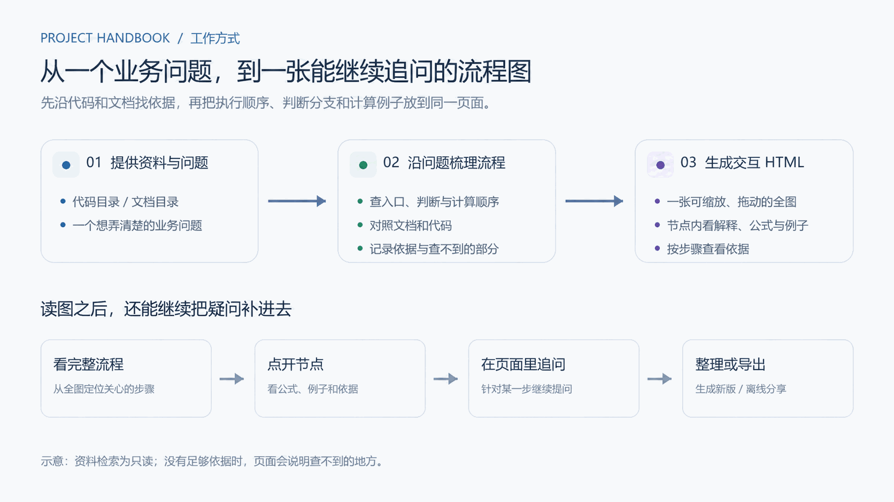
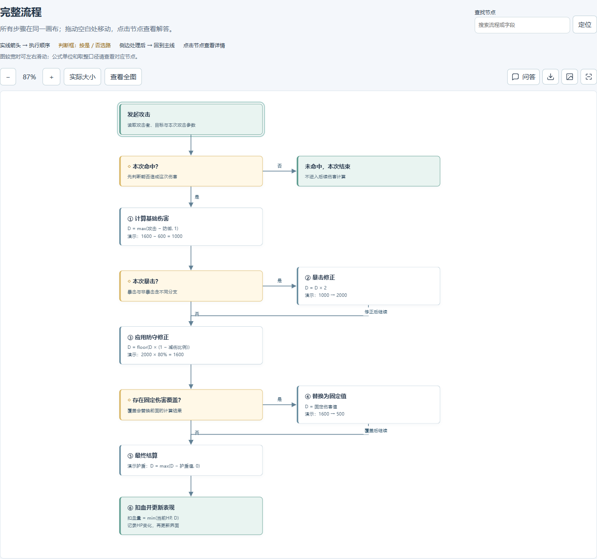
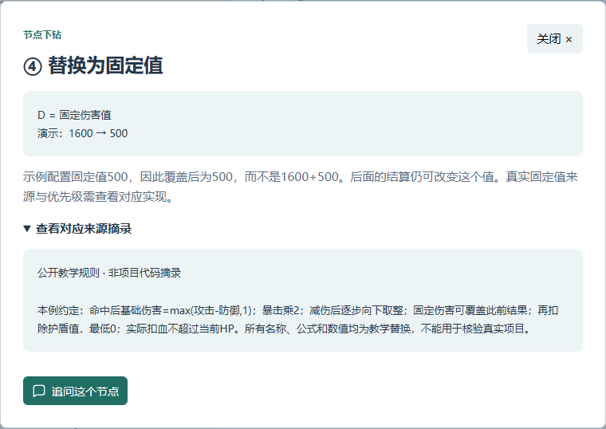
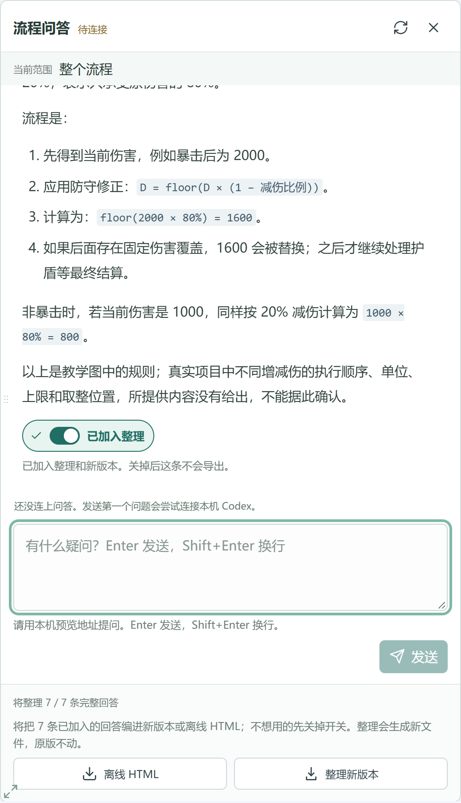

# Project Handbook

给 Codex 代码目录、文档目录和一个业务问题，生成一张能沿着步骤阅读、追问和分享的交互流程图。

适合接手新项目、回头梳理老项目时，弄清某个结果是怎样一步步产生的。输出是一份 HTML：先看完整执行路径，再点开节点看解释、计算例子和依据。

## 从问题到流程图



Codex 会在提供的目录内只读查找与问题有关的代码和文档，梳理入口、判断分支、计算顺序及结果。文档与代码不一致、资料不足的地方会标出来。之后可以在页面里针对具体节点追问，再决定是否把补充回答整理进新版本。

## 看一个脱敏示例

示例问题是：**目前游戏中的伤害流程是怎样的？** 以下图片来自生成的真实页面。项目名称、代码路径、字段和业务数值没有公开；公式中的数字替换为教学数据。

### 1. 看完整路径

命中、基础伤害、暴击、减伤、固定伤害覆盖、结算与扣血都在同一张画布上。打开时按页面宽度显示、从第一步开始读；可以缩放、拖动和搜索节点（按 `/` 直接查找）。流程分成几段时，每段标题写在图上，上方的「跳到」可以直达某一段。



### 2. 点开节点看细节

节点详情展示该步骤做什么、公式和数值例子，以及对应的来源摘录。详情里还列出「从这里来」和「接下来」（含 是/否 等分支条件），点一下就走到相邻那一步，不用回到图上找。下面的示例展示了固定伤害如何覆盖前一步的计算结果。

页面下方的数值例子可以点 **在图上看这条路线**：例子经过的节点按顺序编号，其余部分淡化，按 Esc 或「退出路线」恢复。



### 3. 沿着疑问继续追问

点击 **追问这个节点**，可以直接在页面右侧问“为什么固定伤害是覆盖前面的结果，而不是再加一次？”回答会保存在本机，不会因为一次追问重新生成整张图。已有分析不足时，问答会在所提供目录内只读检索；找不到依据会说明。



## 快速开始

先把下面这句话发给 Codex，让它安装 Skill：

```text
帮我安装下这个 skill：
https://github.com/GXGXX/project-handbook/tree/main/project-handbook
```

安装后，提供目录并提问。把示例路径换成自己的即可；暂时缺少某个目录也可以使用。

```text
使用 $project-handbook。

这是客户端目录：D:/demo/client
这是服务端目录：D:/demo/server
这是文档目录：D:/demo/docs

目前游戏中的伤害流程是怎样的？
```

Codex 会输出 HTML 文件并打开本机阅读地址。安装后若未显示该 Skill，可重启 Codex。

## 阅读与分享

- **继续追问**：使用 Codex 打开的本机阅读地址，保持本机 Codex 和问答连接运行。下载的离线 HTML 可以阅读，但不能继续提问。
- **更新流程图**：在回答末尾打开 **加入整理**，选中想保留的回答，再点 **整理新版本**。原版会保留，这一步需要重新整理和核对流程结构。新版本保留来源摘录，打开后可以接着追问，也可以在它的基础上再整理。
- **分享已有内容**：选中回答后直接导出 **离线 HTML**，无需重新调用模型。接收方可以查看流程、节点详情和选中的问答，无需安装 Codex。
- **只要图片**：导出 **全图 PNG**。图片保留画面；交互细节和问答适合用离线 HTML 分享。

分享副本默认移除连接凭据、原始来源摘录和可识别的私人路径等信息。业务名称、数字和文字内容仍需在对外分享前自行确认。
