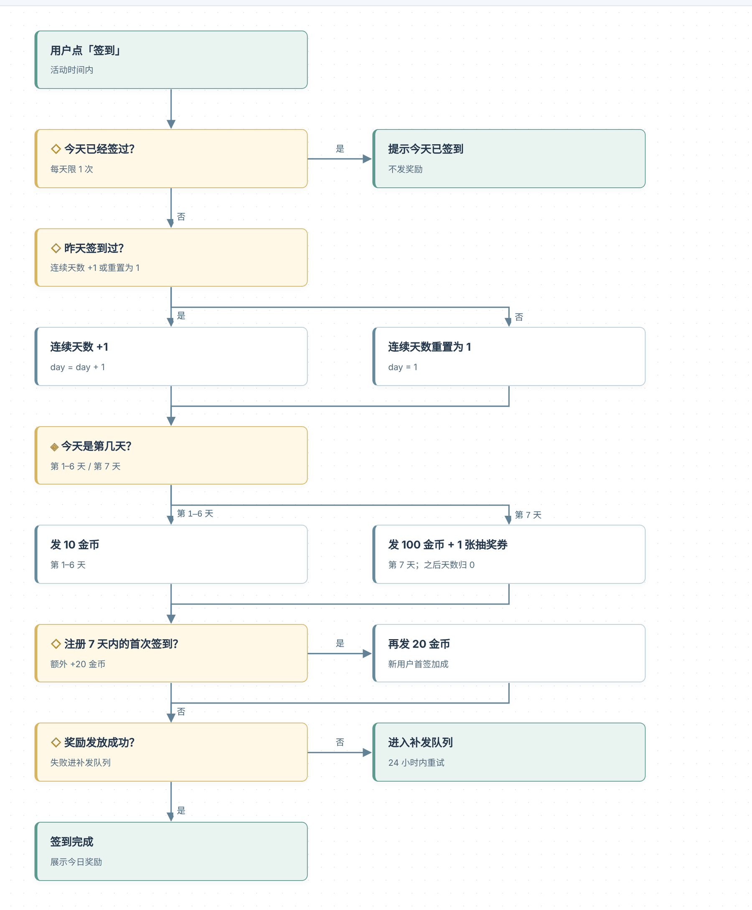
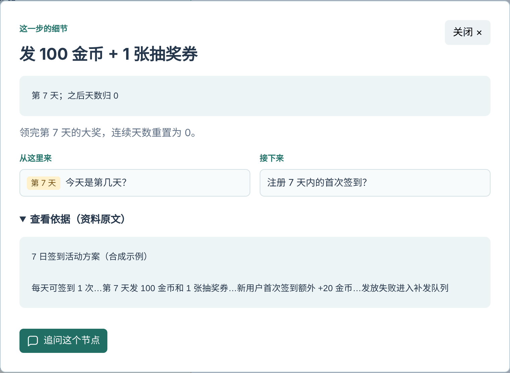
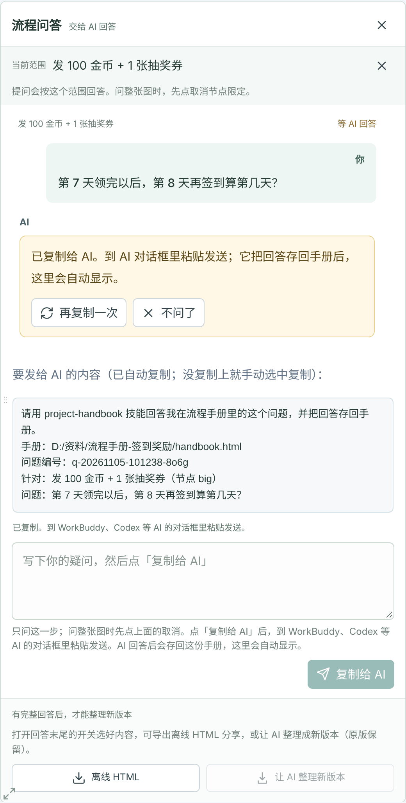
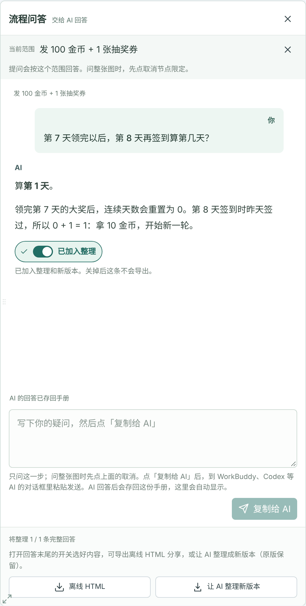
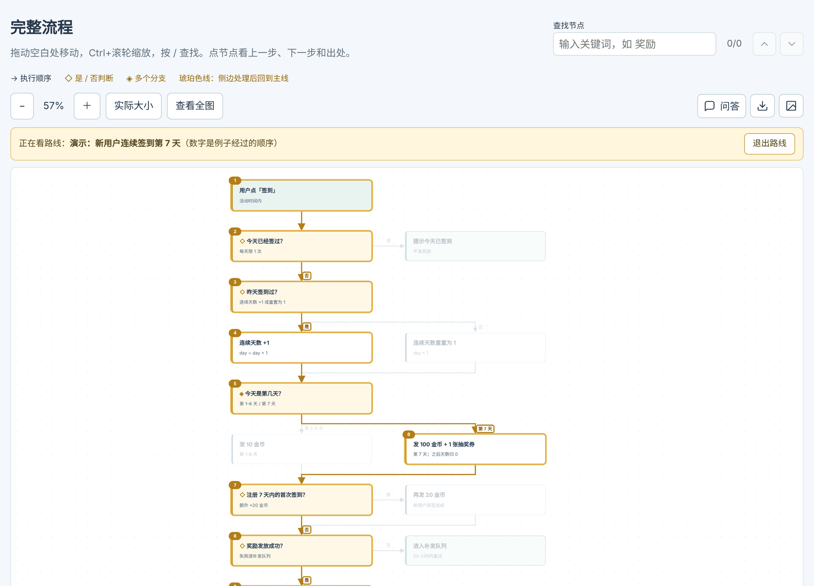

# Project Handbook · 流程手册

把「这个流程是怎么走的」「这个数是怎么算出来的」讲成一张能点、能问、能分享的流程图网页。

给 AI 一个资料文件夹（产品文档、活动方案、配置表，或者项目代码都行）和一个问题，它会读完资料，生成一份 `handbook.html`：双击就能打开，整个流程在一张图上，每一步都能点开看规则、公式、数值例子和原文依据。看不懂的地方可以直接在网页里提问。

适合产品、运营、策划，以及刚接手项目的人。不用写代码，不用配置 API key，用的就是你在 WorkBuddy、Codex 等 AI 工具里本来的账号和模型。


## 安装

先下载安装包 [project-handbook.zip](https://github.com/GXGXX/project-handbook/releases/latest/download/project-handbook.zip)。

- **WorkBuddy**：打开「技能」→「添加技能」→「上传技能」，选择下载的 zip。也可以把解压出来的 `project-handbook` 文件夹放进 `C:\Users\你的用户名\.workbuddy\skills\`（Mac 是 `~/.workbuddy/skills/`），然后重启 WorkBuddy。
- **Codex**：把这句话发给 Codex：

  ```text
  帮我安装下这个 skill：
  https://github.com/GXGXX/project-handbook/tree/main/project-handbook
  ```

- **其他支持 Skills 的 AI 工具**（Claude Code、OpenClaw 等）：把 `project-handbook` 文件夹放进它的 skills 目录。

装好后如果看不到这个技能，重启一下 AI 工具。

## 三步用起来

1. **准备资料**：把要问的那部分资料放在一个文件夹里，比如活动方案、需求文档、配置表；有项目代码也可以一起给。
2. **提问**：在 AI 对话框里说清楚资料在哪、想弄明白什么。例如：

   ```text
   用 project-handbook 帮我梳理一下。
   资料在：D:/资料/双十一活动
   问题：用户完成任务后，奖励是怎么判断和发放的？
   ```

   ```text
   用 project-handbook，资料在 D:/资料/会员体系。
   会员等级是怎么升降的？每一级的权益怎么算？
   ```

3. **打开网页**：AI 会告诉你生成的 `handbook.html` 在哪，双击用浏览器打开就行。

## 在网页里继续问

- 点任意一步，看这一步的规则、公式、数值例子和原文依据，也能顺着「从这里来 / 接下来」一步步往下走。
- 有疑问就点右上角 **问答**（或某一步里的 **追问这个节点**），写下问题，点 **复制给 AI**，再回到 AI 对话框粘贴发送。AI 会用资料回答，并把答案存回这份网页，几秒后页面上就会出现。
- 觉得某些回答应该写进流程图，打开回答下面的 **加入整理**，再点 **让 AI 整理新版本**，同样粘贴给 AI。它会生成一份新的网页，原来那份保留。
- 用 Codex 时，AI 还可以额外给一个本机链接，用它打开的网页可以直接问答，不用来回粘贴。

## 分享给同事

- **离线 HTML**：在问答面板里选好想带上的回答，点导出。得到的单个文件可以直接发微信、发邮件，对方双击就能看，不需要安装任何东西；这份副本只能看，不能继续提问。
- **全图 PNG**：只要一张图时用。

导出的文件会去掉本机路径、资料原文摘录和看起来像密码、密钥的内容，但业务规则、数字本身还在，对外发之前请自己确认能不能公开。

## 看一个示例

资料是一份合成的「7 日签到活动方案」，问题是：**用户签到后，奖励是怎么判断和发放的？** 下面的图都来自 AI 生成的真实网页，示例数据在 [docs/examples/checkin.flow.json](docs/examples/checkin.flow.json)。

### 1. 一张图看完整流程

每天能签几次、断签怎么算、第几天发什么、新用户加成、发放失败怎么办，都在一张图上。◇ 是「是/否」判断，◈ 是多个分支。



### 2. 点开任意一步

看这一步的规则、它从哪一步来、接下来去哪，以及资料里的原文依据。点「从这里来 / 接下来」就能一步步往下走。



### 3. 在网页里提问

写下疑问，点 **复制给 AI**，再到 AI 对话框里粘贴发送：



AI 回答后会把答案存回这份网页，几秒后自动出现，不用重新生成：



### 4. 跟着例子走一遍

网页下方的数值例子点 **在图上看这条路线**，例子经过的每一步按顺序编号，其余部分变淡。



### 也能看项目代码

给的是代码和配置表也一样。下图是一个游戏项目的伤害结算流程（已脱敏，数字换成了教学数据）：


## 常见问题

**电脑上没装 Python 能用吗？** 能。有 Python 时 AI 会用它来检查和生成网页；没有时会直接用技能里自带的网页模板，效果一样。

**需要 API key 或者额外付费吗？** 不需要。生成和回答都是你正在用的那个 AI 在做，消耗的是它本来的额度。

**用哪个模型比较好？** 资料越多、流程越复杂，越推荐用推理能力强的模型。生成后请对照资料抽查几步，特别是数字和判断条件。

**在网页里提的问题，回答一直没出现？** 先确认已经把复制的内容粘贴发送给了 AI，并且它回复说已存回手册；然后刷新一下网页。网页文件挪过位置的话，复制出来的路径可能不对，告诉 AI 网页现在在哪就行。

**会改动我的资料吗？** 不会。AI 只读资料文件夹，生成的网页放在另一个新文件夹里。

**网页打不开、提示数据有问题？** 点提示下面的 **复制给 AI**，粘贴给生成它的 AI，它会修好后重新生成。

## 给开发者

- 技能本体在 `project-handbook/`：`SKILL.md` 是给 AI 的说明，`scripts/build_flow.py` 生成网页，`assets/viewer/handbook.html` 是不需要 Python 时使用的网页模板。改了 `assets/` 里的页面代码后，运行 `python project-handbook/scripts/build_flow.py --viewer` 重新生成模板。
- 测试：`python -m unittest discover -s tests`，以及 `tests/*.cjs` 的浏览器测试（需要 Playwright）。
- README 里的截图来自 `docs/examples/checkin.flow.json`（合成数据），用 `build_flow.py` 生成后截图。
- `evals/` 是内容质量评测：用公开项目的问题检查生成的流程图对不对，说明见 [evals/README.md](evals/README.md)。
- 打标签 `v*` 会自动打包 `project-handbook.zip` 并发布到 Releases。
